# Task 2: FastAPI + MySQL with ConfigMap, Secret & Ingress

A two-tier guestbook application on the 3-node Minikube cluster from Task 1 (profile `task1`):
a **FastAPI** app (2 replicas) that reads and writes to **one MySQL** server, exposed through an **NGINX Ingress**.

## Architecture at a glance

**Diagram 1: where things physically run** (cluster, nodes, Pods, containers, namespaces)

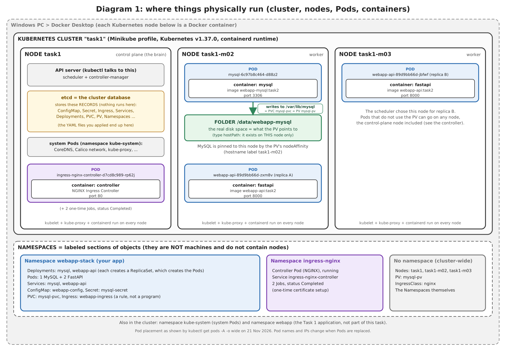

**Diagram 2: the path of one request**, and what each piece is for

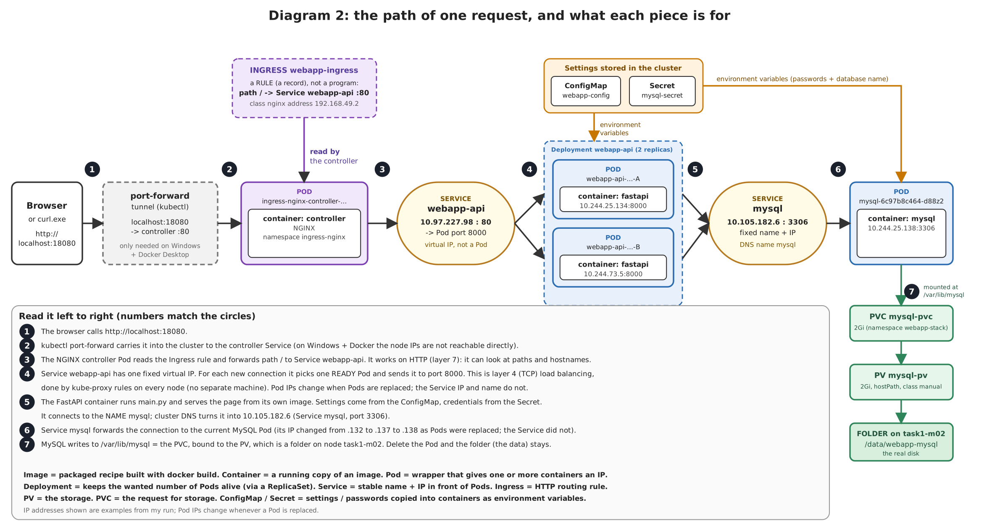

> Pod placement shown here comes from `kubectl get pods -A -o wide`. IP addresses and Pod names are examples from my run: they change when a Pod is replaced. MySQL is the only Pod that is pinned to a node (`task1-m02`, by the PV); the scheduler placed the others.

## Architecture explained

### 1. Images, containers and Pods

- An **image** is a packaged recipe, built with `docker build`. A **container** is a running copy of an image. A **Pod** is a small wrapper that gives one or more containers one IP address (each Pod in this project holds exactly one container).
- `webapp-api:task2` was **built by me** from the course folder `webapp/`: a Python base image plus `requirements.txt`, `main.py` and the `static/` files (the HTML and CSS of the web page).
- `webapp-mysql:task2` was **built on top of the official `mysql:8.4` image** (pulled from Docker Hub) with the course config, the schema and the fixed init script (`mysql.Dockerfile`).
- Both images were loaded into Minikube (`minikube image load`), because every node has its own image storage, separate from Docker Desktop.

### 2. Cluster, nodes, Pods, containers (Diagram 1)

```
Windows PC > Docker Desktop > Cluster "task1"
                              ├── Node task1      (control plane: API server, scheduler, etcd database)
                              ├── Node task1-m02  (worker)  ── Pods ── containers
                              └── Node task1-m03  (worker)  ── Pods ── containers
```

Where the Pods of this project actually run (from `kubectl get pods -A -o wide`):

| Node | Pods of this project |
|---|---|
| `task1` (control plane) | `ingress-nginx-controller-d7cd8c989-rp62j`, plus the system Pods (etcd, API server, scheduler, CoreDNS, Calico, kube-proxy) |
| `task1-m02` (worker) | `mysql-6c97b8c464-d88z2`, `webapp-api-89d9bb66d-zxm8v` |
| `task1-m03` (worker) | `webapp-api-89d9bb66d-jbfwf` |

The control-plane node also runs ordinary Pods in this Minikube cluster (the ingress controller, and the Task 1 application in the `webapp` namespace).

- Each node is itself a **Docker container** (only because Minikube runs on Docker; in a real cluster nodes are servers or VMs). Inside the nodes, **containerd** runs the application containers.
- Pods in the `webapp-stack` namespace: **3** (1 MySQL + 2 FastAPI). The ingress controller adds **1** Pod in `ingress-nginx`, plus 2 one-time Jobs that show `Completed`, plus the system Pods in `kube-system`.
- A Deployment does not create Pods directly: it creates a **ReplicaSet**, which keeps the wanted number of Pods running. That is why a Pod name looks like `mysql-6c97b8c464-d88z2` (Deployment `mysql`, ReplicaSet `6c97b8c464`, Pod `d88z2`).

### 3. Namespaces

A namespace is a **labeled section for objects** (Pods, Services, Secrets ...). It does **not** contain nodes. Nodes belong to the cluster. Every object of this task is in `webapp-stack`, except the PV, the nodes and the IngressClass (cluster-wide), and the NGINX controller (`ingress-nginx`).

### 4. Records vs running programs

| Object | Is it running somewhere? | What it really is |
|---|---|---|
| ConfigMap `webapp-config` | No | A record in the cluster database (etcd). Its values are copied into the containers as environment variables when they start |
| Secret `mysql-secret` | No | Same, for the credentials |
| Ingress `webapp-ingress` | No | A routing **rule**: path `/` goes to Service `webapp-api:80` |
| Ingress **controller** | Yes (a Pod, NGINX) | The program that reads the rule and forwards the traffic |
| Deployment | No | A record that tells Kubernetes to keep N Pods alive |

### 5. Storage: MySQL, PV, PVC, StorageClass

- **MySQL is a Pod** (created by the `mysql` Deployment), not a PV or a PVC. The PV and the PVC are only the disk it writes to.
- Chain: **MySQL Pod -> PVC `mysql-pvc` -> PV `mysql-pv` -> folder `/data/webapp-mysql` on node `task1-m02`.** The Pod mounts the PVC at `/var/lib/mysql` and never touches the PV directly.
- The **PV** is the storage resource (cluster-wide, no namespace). The **PVC** is the request for it (inside `webapp-stack`).
- **Storage type** = `hostPath`: a plain folder on one node. That is why the PV has `nodeAffinity` for `task1-m02`: without it the Pod could start on another node and find an empty folder.
- **`manual` is only a label**, not a real StorageClass object (`kubectl get storageclass` only lists `standard`). It makes the PVC bind to my PV instead of Minikube creating its own volume under the default class.

### 6. Services, IPs, ports and load balancing

A Service is not a Pod and not a container, and it does not live on one node. It is a **fixed virtual IP and DNS name**; kube-proxy rules on **every node** make it work.

| Thing | Address in my run | Notes |
|---|---|---|
| Service `mysql` | `10.105.182.6:3306` | Fixed. Forwards to the current MySQL Pod |
| MySQL Pod | `10.244.25.138:3306` | Changed from `.132` to `.137` to `.138` as Pods were replaced |
| Service `webapp-api` | `10.97.227.98:80` | Forwards to the Pods' port **8000** (`targetPort`) |
| App Pods | `10.244.25.134:8000`, `10.244.73.5:8000` | The two endpoints |
| Ingress | `192.168.49.2:80` | Address of a node in the Minikube network |
| My tunnel | `localhost:18080` -> controller `:80` | Needed only because of Windows + Docker |

- The app reaches MySQL by the **name `mysql`**: cluster DNS turns it into the Service IP, and kube-proxy forwards to the current MySQL Pod. The Pod IP can change without the app noticing.
- **Load balancing:** a Service balances at **layer 4 (TCP)**. For each new connection, rules on the node (iptables, maintained by kube-proxy) choose one of the **ready** Pods. There is no separate load-balancer machine. The Ingress controller works at **layer 7 (HTTP)**, so it can route by path or hostname.

### 7. Where the web page comes from

The `Task-2` folder holds only Kubernetes files. The website (`index.html`, `style.css`) is inside the **app image**: `docker build` copied the course `webapp/app/static/` folder into it, and `main.py` serves it. The page also shows which app Pod answered and which MySQL Pod stored the data.

### 8. How the YAML files in this repository relate

Each file is the blueprint of one object. It creates the records in the cluster; the running Pods are then created from them.

| File | Creates |
|---|---|
| `namespace.yaml` | Namespace `webapp-stack` |
| `secret.yaml`, `configmap.yaml` | The Secret and the ConfigMap |
| `pv.yaml`, `pvc.yaml` | The storage chain |
| `mysql-deployment.yaml` | The MySQL Pod (through a ReplicaSet) |
| `mysql-service.yaml` | The name and IP `mysql` |
| `webapp-deployment.yaml` | The 2 FastAPI Pods |
| `webapp-service.yaml` | The name and IP `webapp-api` |
| `ingress.yaml` | The routing rule |

**Not in this repository:** the application code and the original MySQL files (they come from the course repository; `mysql.Dockerfile` needs them next to it), the built images, the NGINX Ingress controller (installed by the Minikube addon), and the guestbook messages themselves (they live in the folder on `task1-m02`).

## Files in this folder

| File | What it creates |
|------|-----------------|
| `namespace.yaml` | Namespace `webapp-stack` |
| `secret.yaml` | Secret `mysql-secret` (3 keys: `root-password`, `app-user`, `app-password`) |
| `configmap.yaml` | ConfigMap `webapp-config` (5 keys) |
| `pv.yaml` | PersistentVolume `mysql-pv` (2Gi, hostPath `/data/webapp-mysql`, pinned to `task1-m02`) |
| `pvc.yaml` | PersistentVolumeClaim `mysql-pvc` (2Gi, storageClass `manual`) |
| `mysql-deployment.yaml` | Deployment `mysql` (1 replica, strategy `Recreate`) |
| `mysql-service.yaml` | Service `mysql` (ClusterIP, 3306) |
| `webapp-deployment.yaml` | Deployment `webapp-api` (2 replicas) |
| `webapp-service.yaml` | Service `webapp-api` (ClusterIP, 80 -> 8000) |
| `ingress.yaml` | Ingress `webapp-ingress` (class `nginx`, path `/`) |
| `mysql.Dockerfile` | The course MySQL Dockerfile plus one line that fixes the init script (see step 1) |
| `images/` | The two architecture diagrams |
| `screenshots/` | Evidence for every step |

Note: the Secret contains the lab credentials given by the course, not production passwords.

## 1. Building the images

I built `webapp-api:task2` from `webapp/` and `webapp-mysql:task2` from `mysql/`, then loaded both into Minikube (`minikube -p task1 image load ...`). The Deployments use `imagePullPolicy: IfNotPresent`, so Kubernetes uses these local images.

**Problem and fix.** The MySQL entrypoint *sources* `01-setup.sh` on the first start, so the script must be non-executable and use Linux (LF) line endings. On Windows, Git had converted the script to CRLF, and the first start failed with `$'\r': command not found`, so the `webapp` database was never created. I kept the supplied source unchanged and built the image with `mysql.Dockerfile`, which is the course Dockerfile plus one line that strips the carriage returns and sets mode 644.
Verified inside the image: `-rw-r--r--` and CR count `0`.

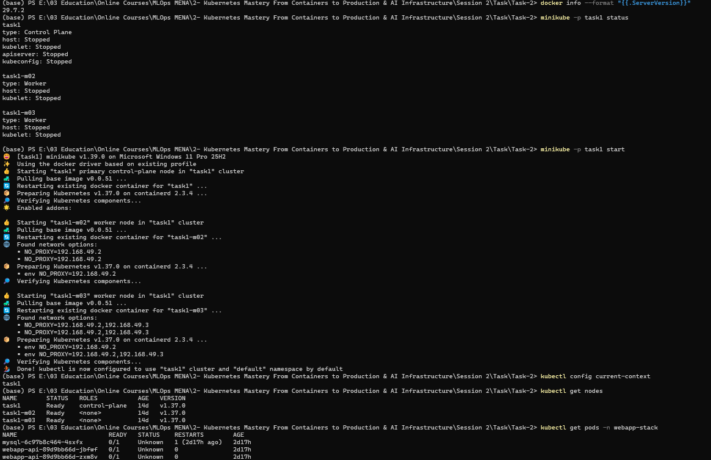
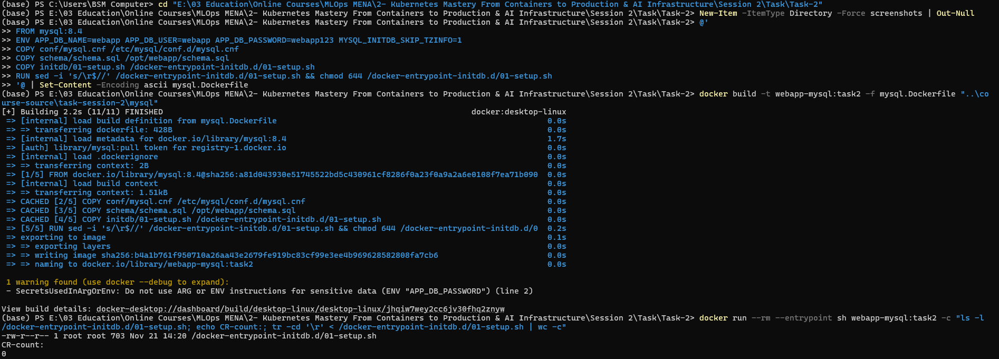

## 2. Resetting MySQL before re-initialization

MySQL creates the database and user only on the first start with an empty data directory. Because the first attempt failed halfway, the data folder on `task1-m02` was already initialized without the `webapp` database. I deleted the `mysql` Deployment (keeping the PV and PVC), replaced the image in Minikube with the fixed one (same image ID as in Docker, `b4a1b7...`), and emptied `/data/webapp-mysql` on the worker node with `minikube ssh`.

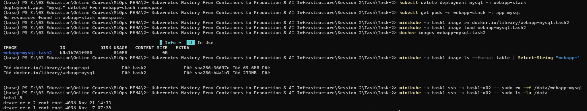

## 3. MySQL Deployment, Service and database initialization

After applying `mysql-deployment.yaml`, the log shows `sourcing /docker-entrypoint-initdb.d/01-setup.sh`, `Creating database 'webapp'` and `ready for connections`. The Pod runs on `task1-m02`, where the PV is pinned. Querying the database inside the Pod returns the 2 default messages, which shows that the Secret (passwords), the ConfigMap (database name) and the PVC (data folder) work together.


## 4. FastAPI Deployment and connection to MySQL

The `webapp-api` Deployment runs 2 replicas. All ConfigMap keys are passed with `envFrom`, and `MYSQL_USER` and `MYSQL_PASSWORD` come from the Secret. `MYSQL_HOST=mysql` works because a Service name is a DNS name inside the namespace. `MYSQL_PORT` is kept in the ConfigMap so it replaces the variable Kubernetes creates automatically for the `mysql` Service.
The checks show `webapp-api 2/2`, the Service endpoints (2 app IPs, 1 MySQL IP), the injected variables, and `/api/info` returning the app version and the MySQL server it reached.

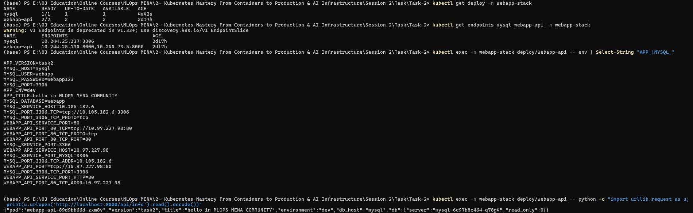

## 5. NGINX Ingress Controller and Ingress

An Ingress only holds routing rules, so I first installed the NGINX Ingress Controller with `minikube -p task1 addons enable ingress` and verified that the controller Pod is Running and the `nginx` IngressClass exists. Then I applied `ingress.yaml`: `webapp-ingress` uses `ingressClassName: nginx` and sends path `/` (Prefix) to the Service `webapp-api` on port 80. The Ingress received the address `192.168.49.2`.

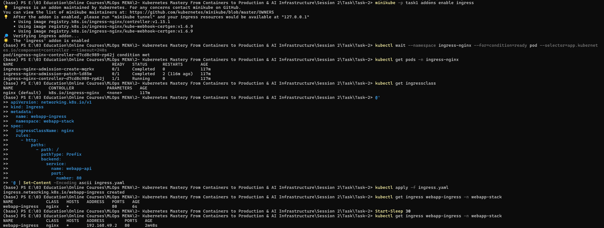

## 6. Opening the app through the Ingress

Port 8080 is reserved on my Windows machine, so I forwarded local port 18080 to the Ingress controller:

```powershell
kubectl port-forward -n ingress-nginx svc/ingress-nginx-controller 18080:80
```

Through this path (browser -> Ingress -> Service `webapp-api` -> app Pod -> Service `mysql`):
- `/health` returns `{"status":"ok"}`.
- `/api/info` shows version `task2`, the ConfigMap title, environment `dev` and the MySQL server.
- `POST /api/messages` created message id 3, written to the MySQL Pod.
- `GET /api/messages` returns my message plus the 2 default ones.
- The web page shows which app Pod answered; both app Pods served requests, so the Service load-balances.

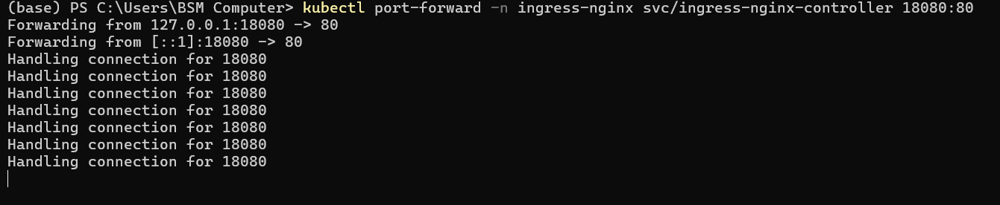
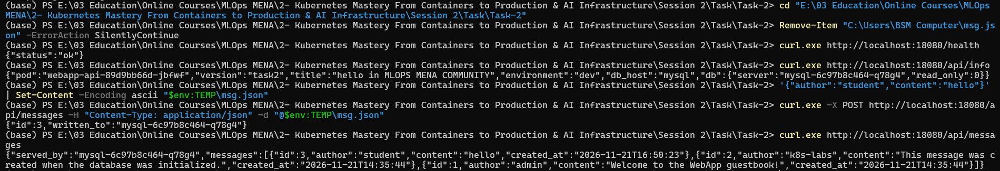
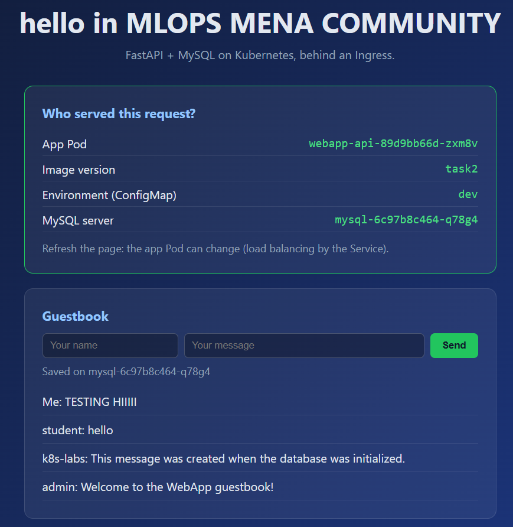

## 7. Data persistence test

Before the test the API returned 4 messages and MySQL ran in Pod `mysql-6c97b8c464-q78g4`. I deleted the Pod with `kubectl delete pod -n webapp-stack -l app=mysql`. Kubernetes created a new Pod `mysql-6c97b8c464-d88z2` on the same node (`task1-m02`, where the PV is pinned), and after it became ready the API returned the same 4 messages, now served by the new Pod. This shows that the data lives on the PersistentVolume (`mysql-pvc` -> `mysql-pv`) and not inside the Pod.


## 8. Final verification

All resources checked at the end (images, Secret and ConfigMap, PV and PVC, Deployments, MySQL Pod on `task1-m02`, Ingress).

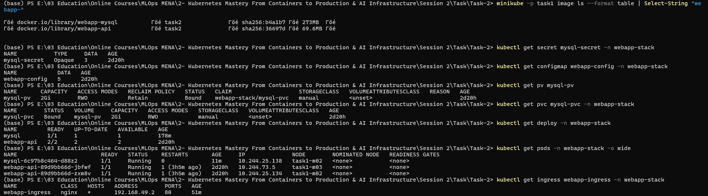

## Notes on my environment

- The assignment's example node name is `minikube-m02`; in my cluster the node is called `task1-m02`, so the PV `nodeAffinity` uses `task1-m02`.
- After a PC restart the Minikube cluster was stopped; I restarted the same cluster with `minikube -p task1 start`.

## How to reproduce

```powershell
kubectl apply -f namespace.yaml
kubectl apply -f secret.yaml
kubectl apply -f configmap.yaml
kubectl apply -f pv.yaml
kubectl apply -f pvc.yaml
kubectl apply -f mysql-deployment.yaml
kubectl apply -f mysql-service.yaml
kubectl apply -f webapp-deployment.yaml
kubectl apply -f webapp-service.yaml
minikube -p task1 addons enable ingress
kubectl apply -f ingress.yaml
```
