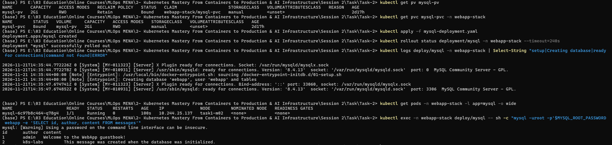
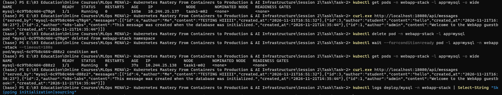

# Task 2: FastAPI + MySQL with ConfigMap, Secret & Ingress

A two-tier guestbook application on the 3-node Minikube cluster from Task 1 (profile `task1`):
a **FastAPI** app (2 replicas) that reads and writes to **one MySQL** server, exposed through an **NGINX Ingress**.

```
Browser -> Ingress (webapp-ingress) -> Service webapp-api (80 -> 8000) -> 2 FastAPI Pods
                                                                              |
                                                          Service mysql (3306) -> MySQL Pod -> PVC mysql-pvc -> PV mysql-pv
ConfigMap webapp-config (app settings)      Secret mysql-secret (credentials)
```

## Files in this folder

| File | What it creates |
|------|-----------------|
| `namespace.yaml` | Namespace `webapp-stack` |
| `secret.yaml` | Secret `mysql-secret` (3 keys: `root-password`, `app-user`, `app-password`) |
| `configmap.yaml` | ConfigMap `webapp-config` (5 keys) |
| `pv.yaml` | PersistentVolume `mysql-pv` (2Gi, hostPath `/data/webapp-mysql`, pinned to `task1-m02`) |
| `pvc.yaml` | PersistentVolumeClaim `mysql-pvc` (2Gi, storageClass `manual`) |
| `mysql-deployment.yaml` | Deployment `mysql` (1 replica, strategy `Recreate`) |
| `mysql-service.yaml` | Service `mysql` (ClusterIP, 3306) |
| `webapp-deployment.yaml` | Deployment `webapp-api` (2 replicas) |
| `webapp-service.yaml` | Service `webapp-api` (ClusterIP, 80 -> 8000) |
| `ingress.yaml` | Ingress `webapp-ingress` (class `nginx`, path `/`) |
| `mysql.Dockerfile` | The course MySQL Dockerfile plus one line that fixes the init script (see step 1) |

Note: the Secret contains the lab credentials given by the course, not production passwords.

## 1. Building the images

I built `webapp-api:task2` from `webapp/` and `webapp-mysql:task2` from `mysql/`, then loaded both into Minikube (`minikube -p task1 image load ...`). The Deployments use `imagePullPolicy: IfNotPresent`, so Kubernetes uses these local images.

**Problem and fix.** The MySQL entrypoint *sources* `01-setup.sh` on the first start, so the script must be non-executable and use Linux (LF) line endings. On Windows, Git had converted the script to CRLF, and the first start failed with `$'\r': command not found`, so the `webapp` database was never created. I kept the supplied source unchanged and built the image with `mysql.Dockerfile`, which is the course Dockerfile plus one line that strips the carriage returns and sets mode 644.
Verified inside the image: `-rw-r--r--` and CR count `0`.


## 2. Resetting MySQL before re-initialization

MySQL creates the database and user only on the first start with an empty data directory. Because the first attempt failed halfway, the data folder on `task1-m02` was already initialized without the `webapp` database. I deleted the `mysql` Deployment (keeping the PV and PVC), replaced the image in Minikube with the fixed one (same image ID as in Docker, `b4a1b7...`), and emptied `/data/webapp-mysql` on the worker node with `minikube ssh`.


## 3. MySQL Deployment, Service and database initialization

After applying `mysql-deployment.yaml`, the log shows `sourcing /docker-entrypoint-initdb.d/01-setup.sh`, `Creating database 'webapp'` and `ready for connections`. The Pod runs on `task1-m02`, where the PV is pinned. Querying the database inside the Pod returns the 2 default messages, which shows that the Secret (passwords), the ConfigMap (database name) and the PVC (data folder) work together.



## 4. FastAPI Deployment and connection to MySQL

The `webapp-api` Deployment runs 2 replicas. All ConfigMap keys are passed with `envFrom`, and `MYSQL_USER` and `MYSQL_PASSWORD` come from the Secret. `MYSQL_HOST=mysql` works because a Service name is a DNS name inside the namespace. `MYSQL_PORT` is kept in the ConfigMap so it replaces the variable Kubernetes creates automatically for the `mysql` Service.
The checks show `webapp-api 2/2`, the Service endpoints (2 app IPs, 1 MySQL IP), the injected variables, and `/api/info` returning the app version and the MySQL server it reached.


## 5. NGINX Ingress Controller and Ingress

An Ingress only holds routing rules, so I first installed the NGINX Ingress Controller with `minikube -p task1 addons enable ingress` and verified that the controller Pod is Running and the `nginx` IngressClass exists. Then I applied `ingress.yaml`: `webapp-ingress` uses `ingressClassName: nginx` and sends path `/` (Prefix) to the Service `webapp-api` on port 80. The Ingress received the address `192.168.49.2`.


## 6. Opening the app through the Ingress

Port 8080 is reserved on my Windows machine, so I forwarded local port 18080 to the Ingress controller:

```powershell
kubectl port-forward -n ingress-nginx svc/ingress-nginx-controller 18080:80
```

Through this path (browser -> Ingress -> Service `webapp-api` -> app Pod -> Service `mysql`):
- `/health` returns `{"status":"ok"}`.
- `/api/info` shows version `task2`, the ConfigMap title, environment `dev` and the MySQL server.
- `POST /api/messages` created message id 3, written to the MySQL Pod.
- `GET /api/messages` returns my message plus the 2 default ones.
- The web page shows which app Pod answered; both app Pods served requests, so the Service load-balances.


## 7. Data persistence test

Before the test the API returned 4 messages and MySQL ran in Pod `mysql-6c97b8c464-q78g4`. I deleted the Pod with `kubectl delete pod -n webapp-stack -l app=mysql`. Kubernetes created a new Pod `mysql-6c97b8c464-d88z2` on the same node (`task1-m02`, where the PV is pinned), and after it became ready the API returned the same 4 messages, now served by the new Pod. This shows that the data lives on the PersistentVolume (`mysql-pvc` -> `mysql-pv`) and not inside the Pod.



## 8. Final verification

All resources checked at the end (images, Secret and ConfigMap, PV and PVC, Deployments, MySQL Pod on `task1-m02`, Ingress).


## Notes on my environment

- The assignment's example node name is `minikube-m02`; in my cluster the node is called `task1-m02`, so the PV `nodeAffinity` uses `task1-m02`.
- After a PC restart the Minikube cluster was stopped; I restarted the same cluster with `minikube -p task1 start`.

## How to reproduce

```powershell
kubectl apply -f namespace.yaml
kubectl apply -f secret.yaml
kubectl apply -f configmap.yaml
kubectl apply -f pv.yaml
kubectl apply -f pvc.yaml
kubectl apply -f mysql-deployment.yaml
kubectl apply -f mysql-service.yaml
kubectl apply -f webapp-deployment.yaml
kubectl apply -f webapp-service.yaml
minikube -p task1 addons enable ingress
kubectl apply -f ingress.yaml
```
